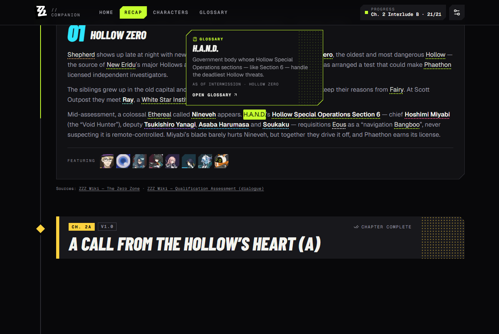
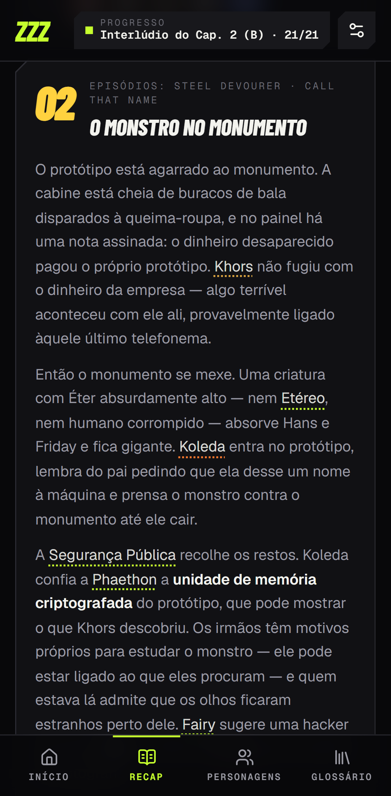
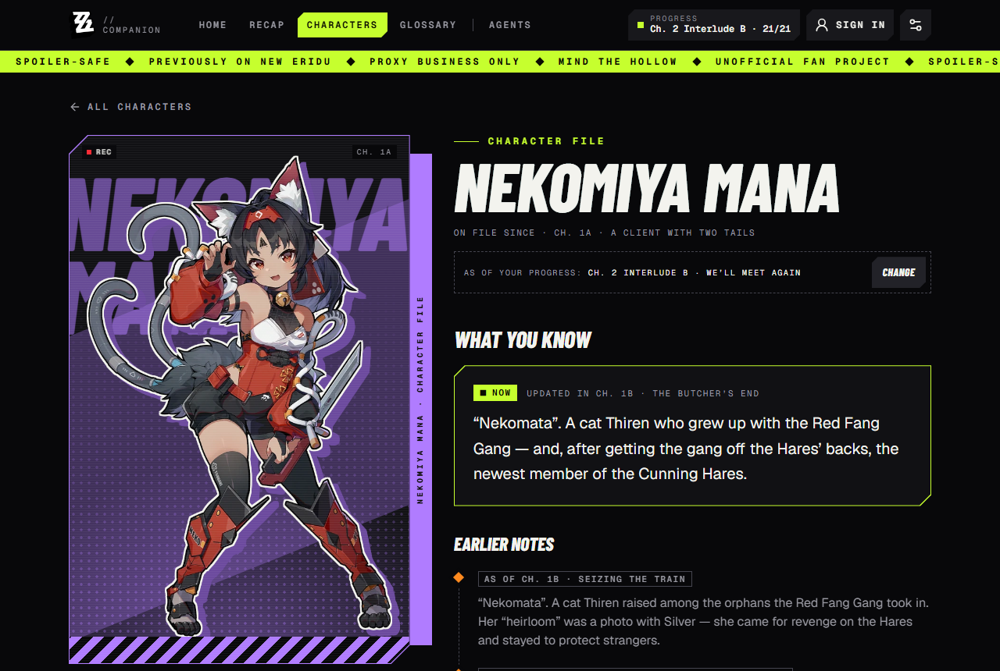
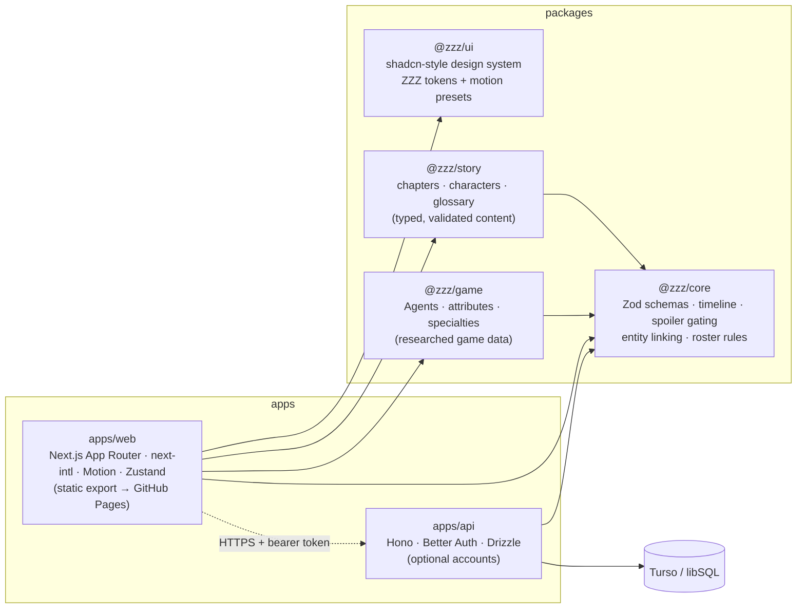

<div align="center">

<a href="https://ldallacqua.github.io/zzz-companion/">
  
</a>

<h3>Forgot what happened in Zenless Zone Zero? Catch up in a minute — without a single spoiler.</h3>

<p>
  <a href="https://ldallacqua.github.io/zzz-companion/"><strong>▶ Open the live app</strong></a>
  &nbsp;·&nbsp;
  <a href="#-features">Features</a>
  &nbsp;·&nbsp;
  <a href="#-quick-start">Quick start</a>
  &nbsp;·&nbsp;
  <a href="#-architecture">Architecture</a>
  &nbsp;·&nbsp;
  <a href="https://ldallacqua.github.io/zzz-companion/storybook/">Storybook</a>
  &nbsp;·&nbsp;
  <a href="AGENTS.md">AI agents</a>
</p>

<p>
  <a href="https://github.com/ldallacqua/zzz-companion/actions/workflows/ci.yml"></a>
  <a href="https://github.com/ldallacqua/zzz-companion/actions/workflows/deploy.yml"></a>
  
  
  
</p>

<p><sub>Unofficial, non-profit fan project. <em>Zenless Zone Zero</em>, the “ZZ” logo and all related names and artwork are trademarks and copyrights of miHoYo / HoYoverse. See <a href="#-license--assets">License &amp; assets</a>.</sub></p>

<p>
  <a href="https://ldallacqua.github.io/zzz-companion/storybook/"></a>
  
  
</p>

<p>
  
  
  
  
  
  
  
</p>

</div>

<br />

<table>
  <tr>
    <td width="66%"></td>
    <td width="34%"></td>
  </tr>
  <tr>
    <td align="center"><sub>Tap any underlined name for a spoiler-safe intel card</sub></td>
    <td align="center"><sub>Built mobile-first</sub></td>
  </tr>
  <tr>
    <td colspan="2"></td>
  </tr>
  <tr>
    <td colspan="2" align="center"><sub>Character files grow as you play — and never show what you haven't reached</sub></td>
  </tr>
</table>

## ✦ Why

ZZZ's story moves fast and patches are weeks apart. Wikis and videos either assume you finished
everything or bury you in spoilers. **ZZZ Companion asks one question — _where are you?_ — and shows
you the story up to exactly that point**, in English or Brazilian Portuguese.

## ✦ Features

|     | Feature                       | What you get                                                                                                                                                                  |
| :-: | ----------------------------- | ----------------------------------------------------------------------------------------------------------------------------------------------------------------------------- |
| 📼  | **Story recap**               | Prologue → Chapter 2 Interlude, part by part, **short** or in **full** — researched from the game's transcripts, with sources.                                                |
| 🛡️  | **Spoiler shield**            | Nothing past your progress appears — not in the recap, the characters or the glossary. Enforced by tests.                                                                     |
| 👆  | **Tap-to-explain names**      | Characters, factions and terms inside the recap — and the faces of who was there — open an intel card, explained _as of that part of the story_, never with later facts.      |
| 🗂️  | **Character files**           | Everyone you've met, each with a file that grows as you play: full-body art, what you know now and how it changed, and every part they appear in. Nothing past your progress. |
| 📖  | **Searchable glossary**       | Hollows, Ethereals, TOPS, H.A.N.D.… unlocked as the story introduces them.                                                                                                    |
| 🧾  | **My Agents roster**          | Tick the Agents you own (all 62, through v3.3) and their Mindscape — search, filters, Mark all. The base for builds and pull advice.                                          |
| ☁️  | **Accounts & sync**           | Optional email + password account that keeps your Agents on every device. Guest picks merge in when you sign in; delete it any time.                                          |
| 🌐  | **English + Português**       | Full pt-BR using the game's official localized terms (Esfera Negra, Etéreo, Interlaço…).                                                                                      |
| 🎬  | **Motion with an off switch** | CRT power-ons, glitch titles, hazard tape and scroll-linked timelines — or _Reduced_ / _Off_ in one tap.                                                                      |
| 📱  | **Phone to desktop**          | Mobile-first with a thumb-friendly tab bar; E2E-tested on phone, tablet and desktop.                                                                                          |
| 🔒  | **Private by default**        | No tracking. Progress and settings live in your browser; an account is optional and only syncs your Agents.                                                                   |

### On the roadmap

- [ ] ⚔️ **Character builds** — recommended W-Engines and Drive Discs, plus what your gear is missing
- [ ] 🎲 **Pull advisor** — should you pull on the current banner? Odds from your pity and currency, weighed against your Agents and plans
- [ ] ✉️ Email for accounts: verification and password reset
- [ ] 📚 More chapters (Chapter 3 onward), Agent Stories as optional tracks
- [ ] 📲 Installable PWA with offline recap

## ✦ Quick start

```bash
corepack enable          # pnpm 10
pnpm install
pnpm dev                 # → http://localhost:3000
```

| Command               | What it does                                                                         |
| --------------------- | ------------------------------------------------------------------------------------ |
| `pnpm dev`            | Start the app with hot reload                                                        |
| `pnpm dev:full`       | App + accounts API together (local SQLite file, no external services needed)         |
| `pnpm verify`         | Format check + typecheck + lint + unit & content tests (**definition of done**)      |
| `pnpm e2e`            | Playwright on mobile / tablet / desktop + axe accessibility                          |
| `pnpm build`          | Production build                                                                     |
| `pnpm screenshots`    | Regenerate the README screenshots                                                    |
| `pnpm storybook`      | Storybook for every component (http://localhost:6006)                                |
| `pnpm test:storybook` | Every story as a test: render + interactions + zero axe violations                   |
| `pnpm lighthouse`     | Static build + Lighthouse CI (Perf ≥ 90 · A11y 100 · Best Practices ≥ 95 · SEO ≥ 95) |

Requires Node ≥ 22.

### Accounts API (optional)

The site works without it. To run sign-in and roster sync locally, use `pnpm dev:full` (API on
http://localhost:8787 with a SQLite file in `apps/api/.data/`). The live site's API runs on
Vercel (`zzz-companion-api`, São Paulo) with its database on Turso next to it. To deploy your own:

1. Create a database on [Turso](https://turso.tech) and a token
   (`turso db create zzz-companion`, `turso db tokens create zzz-companion`).
2. Apply migrations: `DATABASE_URL=libsql://… DATABASE_AUTH_TOKEN=… pnpm --filter @zzz/api db:migrate`
   (again before every deploy that changes the schema).
3. Create a [Vercel](https://vercel.com) project with root directory `apps/api`
   (`vercel project create`, `vercel link`, `vercel project update --root-directory apps/api`).
   `apps/api/vercel.json` sets the install and build commands: `build:vercel` bundles the API into
   one Node.js function (region `gru1`; change it in `apps/api/scripts/build-vercel.mjs` to sit
   next to your database). Add the production variables `DATABASE_URL`, `DATABASE_AUTH_TOKEN`,
   `BETTER_AUTH_SECRET` (32+ random chars), `BETTER_AUTH_URL` (its public URL) and `WEB_ORIGINS`
   (`https://<user>.github.io`), then run `vercel deploy --prod` from the repo root. Other hosts
   that run a Hono fetch handler can serve `apps/api/src/index.ts` instead.
4. Set the repository variable `API_URL` to the API's URL; the next Pages deploy turns accounts on.

## ✦ Architecture



- **Spoiler gating lives in one place** (`@zzz/core`): the UI never compares story order itself.
- **Entries are time-aware**: characters, factions and terms carry `revisions` that unlock as the
  story reveals more, so an intel card in Chapter 1 never uses Chapter 2 facts.
- **Content is code**: every recap part, character and term is typed data with an `unlockedAt`
  gate, validated by Zod and by integrity tests (no character can appear before they're unlocked).
- **Local-first**: progress, preferences and the Agent roster persist in `localStorage`; the site
  is fully static and deploys to GitHub Pages.
- **Optional accounts** ([ADR 0011](docs/adr/0011-accounts-and-roster-sync.md)): a separate Hono
  API with Better Auth (email + password) and Turso syncs the roster across devices. Without it
  (or offline) everything still works on the device; signing in merges what you picked as a guest.
- Decisions are documented as [ADRs](docs/adr); feature specs live in [`docs/features`](docs/features).

```
apps/web          Next.js app — routes, screens, i18n messages, Storybook (.storybook)
apps/api          Accounts API — Hono, Better Auth, Drizzle migrations (drizzle/)
packages/core     Pure TypeScript domain (no React, no I/O)
packages/story    Story content, characters, factions, glossary
packages/game     Game data: every playable Agent, attributes, specialties, factions
packages/ui       Design system components + tokens
docs/             ADRs, feature specs, README assets
```

## ✦ Quality gates

Nothing reaches `main` without passing every gate. The four checks are CI jobs that `main`'s
branch protection requires, and every new feature also gets a UI/UX expert review:

| Gate           | What it guarantees                                                                                                                                                                                                  |
| -------------- | ------------------------------------------------------------------------------------------------------------------------------------------------------------------------------------------------------------------- |
| `pnpm verify`  | Formatting, strict types, lint, unit + content tests (incl. spoiler-leak checks on every text)                                                                                                                      |
| `pnpm e2e`     | Playwright on phone, tablet and desktop (+ iPhone WebKit in CI) with axe                                                                                                                                            |
| **Storybook**  | [Every component has stories](https://ldallacqua.github.io/zzz-companion/storybook/); each story renders, passes its interactions and has zero axe violations                                                       |
| **Lighthouse** | Home, recap, characters, glossary and My Agents audited on the static build: Perf ≥ 90, A11y 100, BP ≥ 95, SEO ≥ 95                                                                                                 |
| **UX review**  | One senior product-designer agent ([`ux-reviewer`](.claude/agents/ux-reviewer.md)) reviews each new feature: hierarchy, states, responsive, a11y, copy in both languages. Blockers and Highs are fixed before merge |

## ✦ Built for humans _and_ AI agents

This repo is **AI-agnostic and AI-ready**: [`AGENTS.md`](AGENTS.md) is the single source of
instructions for Claude Code, Codex, Cursor, Copilot, Gemini CLI and humans alike — commands,
boundaries, content rules and the definition of done (`pnpm verify`). Strict types, Zod schemas and
fast tests let any agent check its own work.

## ✦ Contributing

Contributions are welcome — new chapters especially! Read [`CONTRIBUTING.md`](CONTRIBUTING.md) and
[`AGENTS.md`](AGENTS.md). Story content must be **researched from sources, written in your own
words, gated with `unlockedAt` and translated to both languages**.

## ✦ License & assets

- **Code** — [MIT](LICENSE).
- **Recap text** (`packages/story`) — written for this project after researching the
  [Zenless Zone Zero Wiki](https://zenless-zone-zero.fandom.com/) transcripts; CC BY-SA 4.0 with
  attribution to the wiki.
- **Trademarks & game assets** — _Zenless Zone Zero_, the "ZZ" logo, character names, artwork and
  all related trademarks are the trademarks and copyrights of **miHoYo / HoYoverse** (COGNOSPHERE
  PTE. LTD.). This is an unofficial, non-profit fan project, not affiliated with or endorsed by
  them; their marks are used only to identify the game, with HoYoverse's legal statement on every
  page of the app.
- **What's in the repo** — character art is never committed: it's referenced from the community
  wiki's CDN and loaded by your browser (with a styled fallback if unavailable). The only game file
  in the repo is the "ZZ" mark (`apps/web/public/brand/zzz-mark.png`), shown in the app's nav and
  embedded in the README banner. README screenshots show the app's own UI.
- **Takedown** — if you represent the rights holder and want anything removed, open an issue and it
  will be taken down.

<div align="center">
<br />
<sub>Unofficial fan project — not affiliated with or endorsed by miHoYo / HoYoverse. Zenless Zone Zero and its logo are their trademarks. Made with ♥ for Proxies everywhere.</sub>
</div>
